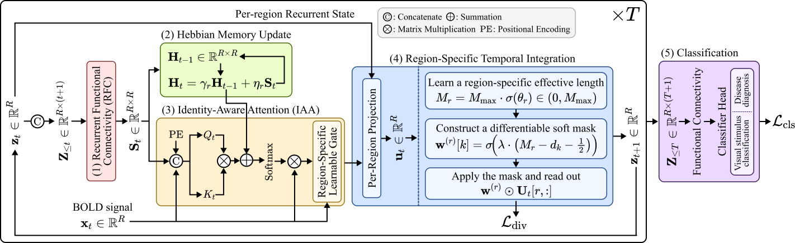

# [NeurIPS 2026] Cortically-Resolved Recurrent Architecture for fMRI

<p align="center">
  
</p>

**CoRTeX** (**Co**rtical **R**ecurrent **T**rajectory e**X**change) is a region-resolved recurrent architecture for fMRI.

We evaluate CoRTeX on task-fMRI stimulus classification (**NSD**) and resting-state fMRI disease diagnosis (**ABIDE**, **COBRE**).

## Repository Layout

```
.
├── main.py
├── configs/
├── dataset/
├── models/
├── training/
└── figures/
```

## Installation

The code was developed using Python 3.10, PyTorch 2.6.0, and CUDA 12.4.

```bash
pip install torch==2.6.0 --index-url https://download.pytorch.org/whl/cu124
pip install numpy==2.2.6 pandas==2.3.3 scikit-learn==1.7.2 scipy==1.15.3 nibabel==5.4.2 PyYAML==6.0.3
```

## Compute Resources

Experiments were conducted on a single NVIDIA RTX 2080 Ti GPU (11 GB).

The main reported runs required approximately 70 GPU-hours in total (~66 h for NSD, ~4 h for ABIDE, and ~1 h for COBRE). Additional compute was used for hyperparameter search and exploratory experiments.


## Run

**NSD:**

```bash
python main.py --task nsd \
    --config configs/experiments/nerf_plus_onehot_hebbian_rsti.yaml \
    --subj 01 --gpu 0 \
    --bold_path /path/to/subj01_bold_R360_T6.npz \
    --bold_avg_path /path/to/subj01_bold_R360_T6_testavg.npz \
    --manifest /path/to/subj01_trial_manifest.csv \
    --split_dir /path/to/splits/subj01 \
    --centroids /path/to/subj01_roi_centroids_voxel_normalized.npy \
    --output runs/nsd/subj01
```

**ABIDE:**

```bash
python main.py --task abide \
    --config configs/experiments/abide_cortex.yaml \
    --fold 0 --gpu 0 \
    --manifest /path/to/abide/manifest.csv \
    --split_json /path/to/abide/splits_5fold_site_dx.json \
    --centroids /path/to/schaefer200_centroids_normalized.npy \
    --output runs/abide/fold0
```

**COBRE:**

```bash
python main.py --task cobre \
    --config configs/experiments/cobre_cortex.yaml \
    --fold 0 --gpu 0 \
    --manifest /path/to/cobre/manifest.csv \
    --split_json /path/to/cobre/splits_5fold_dx.json \
    --centroids /path/to/schaefer200_centroids_normalized.npy \
    --output runs/cobre/fold0
```
`--centroids` is an (R, 3) array of ROI centroid coordinates, in native voxel space for NSD (see `dataset/extract_centroids.py`) and in MNI152 space for the Schaefer-200 atlas (ABIDE, COBRE).

## Citation

```bibtex
@inproceedings{heo2026cortically,
  title={Cortically-Resolved Recurrent Architecture for fMRI},
  author={Heo, Da-Woon and Oh, Kwanseok and Ayuso-Mu{\~n}oz, Adri{\'a}n and Suk, Heung-Il},
  booktitle={Advances in Neural Information Processing Systems},
  year={2026}
}
```

## License

This project is released under the MIT License. See [LICENSE](LICENSE).
